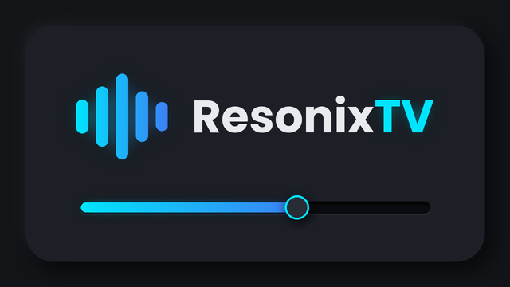

<div align="center">

<br/>



# ResonixTV

### Home-Cinema Audio Player for Android TV

<p>
  <strong>Dialogue too quiet? Subwoofer too loud? Fix it from the couch.</strong><br/>
  <em>Per-channel mixer, graphic and parametric EQ, and FFmpeg decoders for DTS, TrueHD and E-AC3, all driven by your remote.</em>
</p>

<br/>

<p align="center">
  <a href="https://github.com/YOUR_USERNAME/Resonix-TV/releases"></a>
  <a href="https://github.com/YOUR_USERNAME/Resonix-TV/stargazers"></a>
  <a href="https://github.com/YOUR_USERNAME/Resonix-TV/releases"></a>
  <a href="https://github.com/YOUR_USERNAME/Resonix-TV/blob/main/LICENSE"></a>
</p>

<p align="center">
  
  
  
  
  
</p>
<br/>

[**Showcase**](#showcase) · [**Features**](#features) · [**Audio Chain**](#audio-chain) · [**Download**](#download) · [**Remote Control**](#remote) · [**Architecture**](#architecture) · [**Contributing**](#contributing) · [**Support**](#support) · [**Disclaimer**](#disclaimer)

<br/>

</div>

> [!NOTE]
> ResonixTV is made for Android TV and is controlled entirely with the remote. It shapes the sound of the audio it plays; it cannot add detail that is not in the recording. See the [Disclaimer](#disclaimer) for what the sound processing does and does not cover.

---

<a id="about"></a>
## 🌟 About the Project

**ResonixTV** is a native Android TV video player built around one idea: *you* should decide how your movie sounds. It decodes audio with FFmpeg (so DTS, TrueHD and E-AC3 play even when the TV can't), runs every sample through a low-latency C++ sound engine, and puts the controls on a dark neumorphic interface that works with nothing but a D-pad.

Dialogue buried under the soundtrack? Raise the centre channel. A subwoofer that shakes the room at 2 a.m.? Turn the LFE down. A TV with thin speakers? Build your own parametric EQ and keep it for every movie.

No accounts. No ads. No telemetry. Your files stay on your TV; the network is used only to check GitHub for new versions.

---

<a id="showcase"></a>
## 📸 Showcase

<!-- Add your screenshots to the docs/ folder with these names. -->
<div align="center">
  <table>
    <tr>
      <td width="33%" align="center">
        <br />
        <sub><b>Home</b></sub>
      </td>
      <td width="33%" align="center">
        <br />
        <sub><b>Player</b></sub>
      </td>
      <td width="33%" align="center">
        <br />
        <sub><b>Channel Mixer</b></sub>
      </td>
    </tr>
    <tr>
      <td width="33%" align="center">
        <br />
        <sub><b>Graphic EQ</b></sub>
      </td>
      <td width="33%" align="center">
        <br />
        <sub><b>Parametric EQ</b></sub>
      </td>
      <td width="33%" align="center">
        <br />
        <sub><b>Settings</b></sub>
      </td>
    </tr>
  </table>
</div>

---

<a id="features"></a>
## ✨ Features

<div align="center">

<table>
  <tr>
    <td width="50%" valign="top">

#### Sound Control
- **Channel mixer** — up to 7.1 (8 channels). Each channel has its own gain (±12 dB) and mute, plus a master gain and live level meters.
- **Graphic EQ** — 10 bands from 31.5 Hz to 16 kHz, ±12 dB. Fast and simple.
- **Parametric EQ** — 10 bands, each with a filter type (peak, low shelf, high shelf, high-pass, low-pass), frequency (20 Hz – 20 kHz), gain (±15 dB) and Q factor (0.1 – 18). A live response curve shows exactly what you are building.
- **One EQ at a time** — build and save your parametric EQ in the main menu, then switch between it and the graphic EQ while the movie plays.
- **Saved automatically** — every change is stored on the TV, so your sound is there next time.
- **Presets** — Flat, Dialogue boost and Bass boost, plus a one-press reset.
- **Safe by design** — a soft limiter catches peaks, EQ changes glide in without clicks, and a flat chain is bit-exact (nothing is coloured).

#### Interface
- **Dark neumorphic design** — raised cards, pressed-in tracks, neon focus rings.
- **Made for the remote** — every screen works with a D-pad, no touch needed.
- **Interface size** — scale everything from 50 % to 120 % in Settings to suit your screen and sofa distance.

    </td>
    <td width="50%" valign="top">

#### Playback
- **FFmpeg audio decoders** — AC3, E-AC3, DTS, DTS-HD, TrueHD, MLP, FLAC, ALAC, Opus, Vorbis, MP3 and AAC. Android's own decoders are the fallback.
- **Audio & subtitle tracks** — switch language or subtitle on the fly, without leaving the movie.
- **Subtitle files** — `.srt`, `.vtt`, `.ass` and `.ssa` files next to the movie are found and (optionally) switched on automatically.
- **Resume** — continue where you stopped, with preview pictures in *Recently Watched*.
- **On-screen display** — title, progress, buffering, audio format; it hides itself after a time you choose.
- **Seek step** — 5, 10, 15 or 30 seconds per press; hold the key to jump further.

#### Files & Library
- **Storage cards** — internal storage, SD cards and USB drives with live usage bars.
- **Built-in file browser** — folders first, then every common video and audio format (MKV, MP4, AVI, TS, M2TS, FLAC, DTS and many more).
- **Open from anywhere** — "Open with ResonixTV" from a file manager or another app.

#### Tools
- **In-app updater** — checks GitHub Releases and installs the build that matches your TV's CPU.
- **Diagnostics** — shows the audio engine, the FFmpeg decoders and the remote keys the app receives.
- **DSP self-test** — the C++ engine tests itself against theory, on the device and on every release build.

    </td>
  </tr>
</table>

</div>

---

<a id="audio-chain"></a>
## 🎛️ How the Audio Chain Works

Every decoded sample passes through the same chain, in this order:

```
decoded audio ─► channel gain / mute ─► EQ (graphic OR parametric) ─► master gain ─► soft limiter ─► speakers
```

| Stage | What it does |
|---|---|
| **Channel gain / mute** | Raise or lower one speaker (centre for dialogue, LFE for bass) or switch it off. Channel order follows the film's layout, from mono up to 7.1. |
| **Equalizer** | Either the graphic or the parametric EQ, never both. Built from standard RBJ biquad filters in double precision, so low frequencies stay stable. |
| **Master gain** | One level control after the EQ, −12 to +6 dB. |
| **Soft limiter** | Transparent below 95 % of full scale; above that it rounds peaks off smoothly so the output never clips. |

### Graphic or parametric?

| | Graphic EQ | Parametric EQ |
|---|---|---|
| **Bands** | 10, fixed frequencies | 10, fully adjustable |
| **You change** | Gain only | Filter type, frequency, gain and Q |
| **Gain range** | ±12 dB | ±15 dB |
| **Best for** | Quick taste adjustments | Fixing a specific room or speaker problem |
| **Edited** | In the main menu or while watching | In the main menu (while watching you can switch it on or off) |

Both are saved separately. Switching between them never erases the other one.

---

<a id="download"></a>
## 📥 Download & Installation

<div align="center">

<a href="https://github.com/YOUR_USERNAME/Resonix-TV/releases/latest" target="_blank" rel="noopener noreferrer"></a>
<a href="https://apps.obtainium.imranr.dev/redirect?r=obtainium://add/https://github.com/YOUR_USERNAME/Resonix-TV" target="_blank" rel="noopener noreferrer"></a>

Grab the latest signed APK from the [Releases](https://github.com/YOUR_USERNAME/Resonix-TV/releases) page. Android TV 8.0 (API 26) or newer is required.

</div>

### Which file do I need?

Every release contains one APK per processor type. Pick the one for your TV:

| File | For |
|---|---|
| `ResonixTV-<version>-arm64-v8a.apk` | **Most Android TVs, boxes and streaming sticks** (64-bit ARM) |
| `ResonixTV-<version>-armeabi-v7a.apk` | Older or cheaper TVs with a 32-bit system (32-bit ARM) |
| `ResonixTV-<version>-x86_64.apk` | Intel / AMD devices and the Android TV emulator |
| `ResonixTV-<version>-x86.apk` | Old 32-bit Intel devices |
| `ResonixTV-<version>-universal.apk` | Works on all of the above, but is bigger. Take this if you are not sure |

`SHA256SUMS.txt` lists the checksum of every file.

### Installing on the TV
1. Enable **Install unknown apps** for the app you use to open the file (a file manager, the *Downloader* app, etc.).
2. Put the APK on a USB drive, or download it straight on the TV, and open it.
3. Or, from a computer on the same network:
   ```bash
   adb connect <TV-IP>:5555
   adb install -r ResonixTV-<version>-arm64-v8a.apk
   ```

Once installed, the **Update** page in the side menu tells you when a new version is out and can download and install it for you. It picks the right file for your TV by itself.

> **Obtainium:** a release has several APKs, so in the app's settings set *Filter APKs by Regular Expression* to your CPU type, for example `arm64-v8a`.

### Getting Started
1. Open ResonixTV and allow access to your media when asked. For the built-in file browser to see subtitle files next to your movies, also allow **All files access** when Android offers it.
2. On **Home**, choose a storage card to browse, or pick something from *Recently Watched*.
3. While the movie plays, press **DOWN** to open the audio panel: tracks, channel mixer, equalizer and presets.
4. For a full-screen EQ with a response curve, open **EQ** in the side menu.

---

<a id="remote"></a>
## 🎮 Remote Control

**Menus**

| Key | Action |
|---|---|
| UP / DOWN | Choose a section in the side menu, or a line on a page |
| RIGHT / OK | Enter the page |
| LEFT / BACK | Back to the side menu (inside the EQ page, BACK first goes up one level) |

**While a movie plays**

| Key | Action |
|---|---|
| OK / Play-Pause | Play or pause |
| LEFT / RIGHT | Seek back / forward (hold to jump further) |
| UP | Show or hide the on-screen display |
| DOWN or MENU | Open the audio panel |
| BACK | Close the panel → hide the display → leave the movie |

**Audio panel**

| Key | Action |
|---|---|
| LEFT / RIGHT | Change tab (on the tab bar), or choose a channel / band |
| DOWN / OK | Go into the tab |
| UP / DOWN | Change the level of the chosen fader |
| OK | Mute a channel, or reset a band |
| BACK | Up one level |

**Parametric EQ page**

| Key | Action |
|---|---|
| UP / DOWN | Choose a setting (band, type, frequency, gain, Q …) |
| LEFT / RIGHT | Change it (hold for bigger steps) |
| OK | Switch a band on / off, or reset |

---

### Building from Source

The repository has no Gradle wrapper; the CI uses a pinned Gradle version. You need:

- **JDK 17**
- **Gradle 9.6.0**
- **Android SDK** with platform 37 and build-tools 36.0.0
- **NDK 28.2.13676358** and **CMake 3.22.1**

```bash
git clone https://github.com/YOUR_USERNAME/Resonix-TV.git
cd Resonix-TV

# Optional but recommended: build the FFmpeg audio decoders (Linux, takes a while the first time)
NDK_PATH=$ANDROID_HOME/ndk/28.2.13676358 bash scripts/setup_ffmpeg.sh

# Build a debug APK for one CPU type
gradle assembleDebug -Presonix.abis=arm64-v8a
# Built APK will be located at: app/build/outputs/apk/debug/
```

Without the FFmpeg step the app still builds; it then uses the TV's own decoders, which usually cannot play DTS or TrueHD.

Run the DSP self-test on your computer, no phone or TV needed:

```bash
g++ -std=c++20 -O2 -Iapp/src/main/cpp app/src/main/cpp/dsp/*.cpp tools/dsp_selftest_main.cpp -o dsp_selftest
./dsp_selftest
```

### Publishing a Release

Releases are built by GitHub Actions: open **Actions → Release APK → Run workflow**, type the version (for example `1.0.4`) and run it. The workflow builds every CPU type, checks each APK, and publishes them as the release `v1.0.4`. The repository must be **public** so the in-app updater can download without a login.

---

<a id="architecture"></a>
## 🏗️ Architecture & Tech Stack

ResonixTV is a single-module Kotlin app with a C++ sound engine. The engine has no third-party DSP libraries.

| Folder | What it does |
|---|---|
| `app/src/main/cpp/dsp/` | The C++ sound engine: biquad filters, channel gain, EQ, limiter, level meters and the self-test |
| `app/src/main/cpp/jni/` | The bridge between Kotlin and the C++ engine |
| `audio/` | Kotlin side of the engine: settings that are saved, graphic and parametric EQ models, EQ curve maths, the ExoPlayer audio processor |
| `player/` | ExoPlayer setup, FFmpeg renderer factory, play requests |
| `data/` | Storage devices, file browser, watch history, settings, preview pictures |
| `input/` | Remote-control key mapping and routing |
| `ui/` | Compose screens: shell, home, browser, history, player, audio panel, EQ, settings, update, diagnostics, and the neumorphic theme and components |
| `update/` | GitHub release checker, APK picker, downloader and installer |
| `scripts/` | `setup_ffmpeg.sh`, which builds the FFmpeg decoders |
| `.github/workflows/` | The release workflow |

**Built with:** Kotlin · Jetpack Compose · AndroidX Media3 / ExoPlayer · FFmpeg (LGPL build via Media3's `decoder_ffmpeg`) · C++20 through JNI · GitHub Actions

---

<a id="support"></a>
## ☕ Support the Project

ResonixTV is free and open source, with no ads or subscriptions. If it made your movie nights sound better, you can support it by:

- ⭐ **Starring** the repository
- 📣 **Sharing** it with fellow home-cinema fans
- 🐛 **Reporting** bugs and TVs that misbehave on the [issues page](https://github.com/YOUR_USERNAME/Resonix-TV/issues)

<!-- Add your donation links here, for example Ko-fi or PayPal -->

### 📈 Star History

<p align="center">
  <a href="https://star-history.com/#YOUR_USERNAME/Resonix-TV&Date">
    
  </a>
</p>

---

<a id="contributing"></a>
## 💡 Contributing

Contributions are welcome, whether it's a bug fix, a new feature, or better wording.

- Something not working on your TV? Open an [issue](https://github.com/YOUR_USERNAME/Resonix-TV/issues) with the TV or box model, the Android version, the file's audio format (for example *DTS 5.1*) and what you expected. The **Diagnostics** page in Settings shows most of this.
- For bigger changes, open an issue first so we can talk it through.
- Pull requests should build cleanly and keep the **DSP self-test** passing.

### 👥 Contributors

<div align="center">
  <a href="https://github.com/YOUR_USERNAME/Resonix-TV/graphs/contributors">
    
  </a>
</div>

---

<a id="acknowledgments"></a>
## 🤝 Acknowledgments

- **[FFmpeg](https://ffmpeg.org/)** — the audio decoders behind DTS, TrueHD, E-AC3 and more.
- **[AndroidX Media3](https://developer.android.com/media/media3)** — ExoPlayer and the FFmpeg decoder extension.
- **Robert Bristow-Johnson's *Audio EQ Cookbook*** — the filter designs used by both equalizers.
- **Jetpack Compose** — the foundation of the interface.

---

<a id="disclaimer"></a>
## ⚖️ License & Disclaimer

### License
<!-- Choose a license, add a LICENSE file to the repository root, and describe it here. -->
See the [LICENSE](LICENSE) file for details. ResonixTV uses FFmpeg, built as an LGPL-only version (no GPL parts), which is distributed under the LGPL.

### Disclaimer
- **Sound shaping, not magic.** The EQ and the mixer change how a recording sounds. They cannot bring back detail that was never there, and a very loud boost can still sound distorted even though the soft limiter prevents clipping.
- **Not every audio path is processed.** The sound engine works on decoded 16-bit and floating-point audio. Audio that reaches your amplifier as an untouched encoded bitstream (passthrough), and 24-bit PCM output, is left as it is. The format shown at the top of the audio panel tells you what the engine is receiving.
- **Surround formats.** Object-based audio such as Dolby Atmos or DTS:X is played as its normal 5.1 / 7.1 channels; the objects are not rendered.
- **TVs differ.** Android TV hardware and firmware vary a lot. If something misbehaves on your device, please report it with the model name.
- **Privacy.** Everything happens on the TV. ResonixTV does not upload your files, and the only network request it makes by itself is the check for new versions on GitHub.

---

<div align="center">
  Built with care and a lot of movie nights. Enjoy the show! 🎬
</div>
