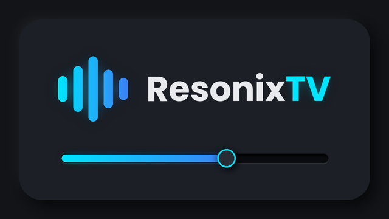
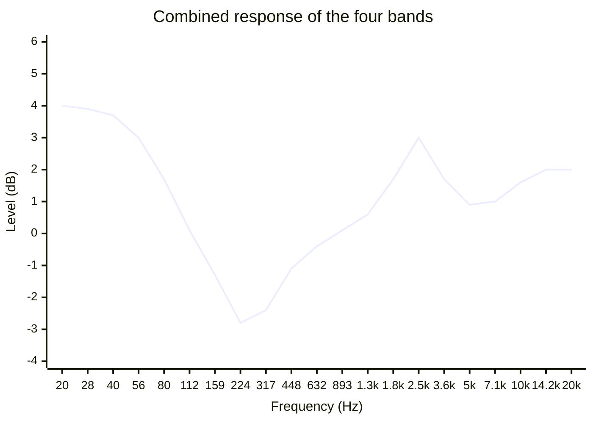
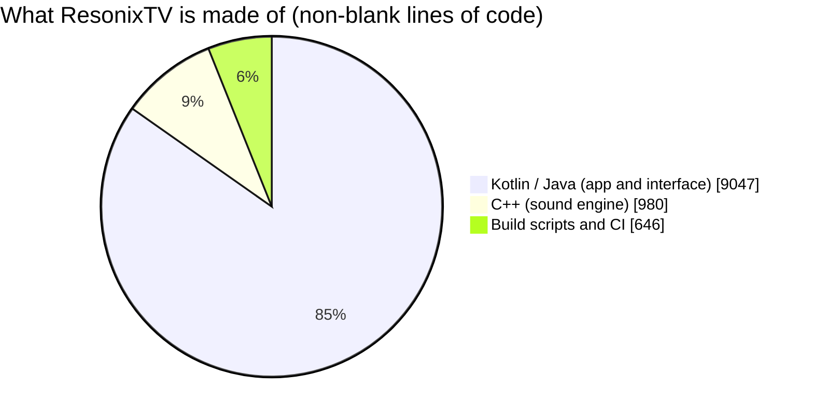

<div align="center">

<br/>



# ResonixTV

### Home-Cinema Audio Player for Android TV

<p>
  <strong>Dialogue too quiet? Subwoofer too loud? Fix it from the couch.</strong><br/>
  <em>Per-channel mixer, graphic and parametric EQ, and FFmpeg decoders for DTS, TrueHD and E-AC3, all driven by your remote.</em>
</p>

<br/>

<p align="center">
  <a href="https://github.com/aravindrejidev/Resonix-TV/releases"></a>
  <a href="https://github.com/aravindrejidev/Resonix-TV/stargazers"></a>
  <a href="https://github.com/aravindrejidev/Resonix-TV/releases"></a>
  <a href="https://github.com/aravindrejidev/Resonix-TV/blob/main/LICENSE"></a>
</p>

<p align="center">
  
  
  
  
  
</p>
<br/>

[**Showcase**](#showcase) · [**Features**](#features) · [**Audio Chain**](#audio-chain) · [**Download**](#download) · [**Network Shares**](#network) · [**Remote Control**](#remote) · [**Settings**](#settings) · [**Architecture**](#architecture) · [**Contributing**](#contributing) · [**Support**](#support) · [**Disclaimer**](#disclaimer)

<br/>

</div>

> [!NOTE]
> ResonixTV is made for Android TV and is controlled entirely with the remote. It shapes the sound of the audio it plays; it cannot add detail that is not in the recording. See the [Disclaimer](#disclaimer) for what the sound processing does and does not cover.

---

<a id="about"></a>
## 🌟 About the Project

**ResonixTV** is a native Android TV video player built around one idea: *you* should decide how your movie sounds. It decodes audio with FFmpeg (so DTS, TrueHD and E-AC3 play even when the TV can't), runs every sample through a low-latency C++ sound engine, and puts the controls on a dark neumorphic interface that works with nothing but a D-pad.

Dialogue buried under the soundtrack? Raise the centre channel. A subwoofer that shakes the room at 2 a.m.? Turn the LFE down. A TV with thin speakers? Build your own parametric EQ and keep it for every movie.

It plays from the TV's own storage, from USB drives and SD cards, and from a NAS or PC on your home network (SMB shares).

No accounts. No ads. No telemetry. Your files stay where they are; the network is used to check GitHub for new versions and, only if *you* add a share, to read your own NAS or PC.

---

<a id="showcase"></a>
## 📸 Showcase

<!-- Add your screenshots to the docs/ folder with these names. -->
<div align="center">
  <table>
    <tr>
      <td width="33%" align="center">
        <br />
        <sub><b>Home</b></sub>
      </td>
      <td width="33%" align="center">
        <br />
        <sub><b>Player</b></sub>
      </td>
      <td width="33%" align="center">
        <br />
        <sub><b>Channel Mixer</b></sub>
      </td>
    </tr>
    <tr>
      <td width="33%" align="center">
        <br />
        <sub><b>Graphic EQ</b></sub>
      </td>
      <td width="33%" align="center">
        <br />
        <sub><b>Parametric EQ</b></sub>
      </td>
      <td width="33%" align="center">
        <br />
        <sub><b>Settings</b></sub>
      </td>
    </tr>
  </table>
</div>

---

<a id="features"></a>
## ✨ Features

<div align="center">

<table>
  <tr>
    <td width="50%" valign="top">

#### Sound Control
- **Channel mixer** — up to 7.1 (8 channels). Each channel has its own gain (±12 dB) and mute, plus a master gain and live level meters.
- **Graphic EQ** — 10 bands from 31.5 Hz to 16 kHz, ±12 dB. Fast and simple.
- **Parametric EQ** — 10 bands, each with a filter type (peak, low shelf, high shelf, high-pass, low-pass), frequency (20 Hz – 20 kHz), gain (±15 dB) and Q factor (0.1 – 18). A live response curve shows exactly what you are building.
- **One EQ at a time** — build and save your parametric EQ in the main menu, then switch between it and the graphic EQ while the movie plays.
- **Three parametric profiles** — keep one EQ for the TV speakers, one for the soundbar, one for headphones, and switch between them.
- **Saved automatically** — every change is stored on the TV, so your sound is there next time.
- **Night mode** — evens out loud and quiet parts (Off / Light / Strong), so dialogue stays clear at low volume and explosions stop waking the house.
- **Presets** — Flat, Dialogue boost and Bass boost, plus a one-press reset.
- **Master switch** — *Channel mixer and EQ* in Settings sends the sound through completely untouched when you want to hear the original. *Reset audio settings* puts the graphic EQ and every channel back to flat and keeps your saved parametric EQ.
- **Safe by design** — a soft limiter catches peaks, EQ changes glide in without clicks, and a flat chain is bit-exact (nothing is coloured).

#### Interface
- **Dark neumorphic design** — raised cards, pressed-in tracks, neon focus rings.
- **Made for the remote** — every screen works with a D-pad, no touch needed.
- **Interface size** — scale everything from 50 % to 120 % in Settings to suit your screen and sofa distance.
- **Status bar** — the time and a Wi-Fi / Ethernet / offline icon at the top of every main page, so you can see at a glance that the TV is on the network.
- **Side menu** — Home, EQ, Settings and Update. A small card at the bottom shows which EQ is working and which preset is loaded.

    </td>
    <td width="50%" valign="top">

#### Playback
- **FFmpeg audio decoders** — AC3, E-AC3, DTS, DTS-HD, TrueHD, MLP, FLAC, ALAC, Opus, Vorbis, MP3 and AAC. Android's own decoders are the fallback.
- **Audio panel** — press DOWN while a movie plays. Six tabs: *Tracks*, *Channels*, *Equalizer*, *Presets*, *Picture* and *Info*.
- **Audio & subtitle tracks** — switch language or subtitle on the fly (or choose *Off*), without leaving the movie. Every track is listed by its language (*Malayalam*, *English* ...) with codec and channel layout below it, so you never have to guess from a file name; a *Commentary* or *Forced* track is marked. The next movie starts with the language you picked last; you can switch this off in Settings.
- **Picture modes** — Fit, Zoom or Stretch, saved for next time.
- **Subtitle looks** — size, a clear outline (white or yellow) and height, so they fit your TV.
- **Next episode** — optional: when a movie ends, the next file in the same folder plays by itself.
- **Subtitle files** — `.srt`, `.vtt`, `.ass` and `.ssa` files next to the movie are found and (optionally) switched on automatically. The size is adjustable in Settings (75 % – 200 %).
- **Resume** — continue where you stopped (a movie that is almost finished starts from the beginning again). The movie pauses by itself when you press HOME or the TV goes to sleep, and returns to the list when it ends. You can switch resuming off in Settings.
- **Match frame rate (24p)** — optional. The TV switches to a refresh rate that fits the movie (24 / 48 / 72 Hz for film, 50 Hz for 25 fps and so on, at the same picture size), so slow pans stop juddering. The screen blinks once while it changes. *Info* shows what was chosen.
- **Playback info** — the *Info* tab of the audio panel shows codec, resolution, HDR, bitrate, which decoders really run (hardware or software, FFmpeg or the TV's own), dropped frames, buffer, the screen mode and where the movie comes from (local file, network share or web link).
- **Self-healing** — after a hiccup (a USB drive that woke up late, a Wi-Fi drop, a decoder that stumbled) the movie restarts by itself, up to twice. If it still fails, an error in plain words tells you what happened and OK tries again. A wrong password on a network share is not retried by the self-healing, and the TV waits 20 seconds before it tries the same login again, so your NAS does not lock the account.
- **On-screen display** — title, progress, buffering, audio format; it hides itself after a time you choose.
- **Fast seeking** — 5, 10, 15 or 30 seconds per press (hold the key to jump further), landing on the nearest keyframe so it stays instant even in big 4K files.

#### Files & Library
- **Storage cards** — internal storage, SD cards and USB drives with live usage bars. A hint card shows up while no USB drive is plugged in.
- **Built-in file browser** — folders first, then every common video and audio format (MKV, MP4, AVI, TS, M2TS, FLAC, DTS and many more). Hidden files and system folders (recycle bins, NAS thumbnail folders) are left out. It remembers the last folder you used.
- **Recently Watched** — Home shows your last 8 movies with preview pictures and a progress bar; *View all* lists up to 30. Press OK to continue where you stopped. *Clear watch history* in Settings removes the list and the pictures.
- **Network shares (SMB)** — play movies from a NAS or a PC. The *Network* card on Home lists your saved shares and *Add share* sets up a new one (name, server, share, user, password, domain or guest login). *Find servers* looks for NAS boxes and PCs on your network by itself, and *Test connection* says in plain words what is wrong (wrong password, server not found, timeout, SMB version). Passwords are encrypted with the Android Keystore and are never written to the log or to the watch history. The same browser, sorting, subtitle files, resume, next-episode autoplay and 24p matching work on a share as on a USB drive, and seeking works too. SMB 2 and SMB 3 only (SMB 1 is not supported); no preview pictures for network files. See [Network Shares](#network) for the full guide.
- **Open from anywhere** — "Open with ResonixTV" from a file manager, a browser or another app, for video and audio files and for web links (`http` / `https`).

#### Tools
- **In-app updater** — the *Update* page checks GitHub Releases, shows what is new, downloads the build that matches your TV's CPU and hands it to Android's installer. The first time, Android asks you to allow ResonixTV to install apps.
- **Diagnostics and error log** — shows the audio engine (and whether Oboe / AAudio is available), the FFmpeg decoders, the remote keys the app receives and the newest lines of a log file that records crashes, player errors, decoders and network-share events (never passwords). Send it along when you report a problem.
- **DSP self-test** — the C++ engine tests itself against theory, on the device and on every release build.

    </td>
  </tr>
</table>

</div>

---

<a id="audio-chain"></a>
## 🎛️ How the Audio Chain Works

Every decoded sample passes through the same chain, in this order:

```
decoded audio ─► channel gain / mute ─► EQ (graphic OR parametric) ─► master gain ─► soft limiter ─► speakers
```

| Stage | What it does |
|---|---|
| **Channel gain / mute** | Raise or lower one speaker (centre for dialogue, LFE for bass) or switch it off. Channel order follows the film's layout, from mono up to 7.1. |
| **Equalizer** | Either the graphic or the parametric EQ, never both. Built from standard RBJ biquad filters in double precision, so low frequencies stay stable. |
| **Master gain** | One level control after the EQ, −12 to +6 dB. |
| **Soft limiter** | Transparent below 95 % of full scale; above that it rounds peaks off smoothly so the output never clips. |

### Graphic or parametric?

| | Graphic EQ | Parametric EQ |
|---|---|---|
| **Bands** | 10, fixed frequencies | 10, fully adjustable |
| **You change** | Gain only | Filter type, frequency, gain and Q |
| **Gain range** | ±12 dB | ±15 dB |
| **Best for** | Quick taste adjustments | Fixing a specific room or speaker problem |
| **Edited** | In the main menu or while watching | In the main menu (while watching you can switch it on or off) |

Both are saved separately. Switching between them never erases the other one.

### Example: a parametric EQ for clearer dialogue

Four of the ten bands are enough here. Together they give the curve below, calculated with the same filter maths the app uses:

| Band | Type | Frequency | Gain | Q | Effect |
|---|---|---|---|---|---|
| 1 | Low shelf | 80 Hz | +4 dB | 0.7 | More punch in the bass |
| 2 | Peak | 250 Hz | −3 dB | 1.0 | Less boominess |
| 3 | Peak | 2.5 kHz | +3 dB | 1.2 | Clearer voices |
| 4 | High shelf | 8 kHz | +2 dB | 0.7 | A little more air |



---

<a id="download"></a>
## 📥 Download & Installation

<div align="center">

<a href="https://github.com/aravindrejidev/Resonix-TV/releases/latest" target="_blank" rel="noopener noreferrer"></a>
<a href="https://apps.obtainium.imranr.dev/redirect?r=obtainium://add/https://github.com/aravindrejidev/Resonix-TV" target="_blank" rel="noopener noreferrer"></a>

Grab the latest signed APK from the [Releases](https://github.com/aravindrejidev/Resonix-TV/releases) page. Android TV 8.0 (API 26) or newer is required.

</div>

### Which file do I need?

Every release contains one APK per processor type. Pick the one for your TV:

| File | For |
|---|---|
| `ResonixTV-<version>-arm64-v8a.apk` | **Most Android TVs, boxes and streaming sticks** (64-bit ARM) |
| `ResonixTV-<version>-armeabi-v7a.apk` | Older or cheaper TVs with a 32-bit system (32-bit ARM) |
| `ResonixTV-<version>-x86_64.apk` | Intel / AMD devices and the Android TV emulator |
| `ResonixTV-<version>-x86.apk` | Old 32-bit Intel devices |
| `ResonixTV-<version>-universal.apk` | Works on all of the above, but is bigger. Take this if you are not sure |

`SHA256SUMS.txt` lists the checksum of every file.

### Installing on the TV
1. Enable **Install unknown apps** for the app you use to open the file (a file manager, the *Downloader* app, etc.).
2. Put the APK on a USB drive, or download it straight on the TV, and open it.
3. Or, from a computer on the same network:
   ```bash
   adb connect <TV-IP>:5555
   adb install -r ResonixTV-<version>-arm64-v8a.apk
   ```

Once installed, the **Update** page in the side menu tells you when a new version is out and can download and install it for you. It picks the right file for your TV by itself.

> **Obtainium:** a release has several APKs, so in the app's settings set *Filter APKs by Regular Expression* to your CPU type, for example `arm64-v8a`.

### Getting Started
1. Open ResonixTV and allow access to your media when asked. For the built-in file browser to see subtitle files next to your movies, also allow **All files access** when Android offers it.
2. On **Home**, choose a storage card to browse, or pick something from *Recently Watched*. To play from a NAS or PC, choose the **Network** card (see [Network Shares](#network)).
3. While the movie plays, press **DOWN** to open the audio panel: tracks, channel mixer, equalizer and presets.
4. For a full-screen EQ with a response curve, open **EQ** in the side menu.

---

<a id="network"></a>
## 🌐 Network Shares (SMB)

Play movies straight from a NAS (Synology, QNAP, a router with a USB disk, a Raspberry Pi with Samba ...) or from a shared folder on a Windows PC or Mac. Nothing is copied to the TV: the movie is read over the network while it plays.

**What you need**
- The TV and the server on the same network (Wi-Fi or cable; cable is best for big 4K files).
- File sharing switched on at the server, with **SMB 2 or SMB 3** (every NAS and PC from the last ten years has it). SMB 1 is not supported.
- A user name and password for the share, or a share that allows guests.

**Add a share**
1. On **Home**, choose the **Network** card, then **Add share**.
2. Press OK on **Find servers on the network** to let the TV look for NAS boxes and PCs, or type the server's name or IP address yourself (an IP such as `192.168.1.20` is the safest).
3. Optionally type the **share name** (for example `Movies`). Leave it empty and the TV shows the usual share names that exist on the server.
4. Type the **user name** and **password**, or switch on **Guest login**. *Domain* is only needed on company networks.
5. Choose **Test connection**. It tells you in plain words if something is wrong. Then choose **Save**.

Press OK on a line to type it: a small box with the TV's keyboard opens. The password box has *Show what I type*, because typing with a remote is easy to get wrong.

**Use a share.** Choose it in the Network list and browse like on a USB drive: folders first, subtitle files next to the movie are found, *Recently Watched* remembers where you stopped, and the next episode can start by itself. Press RIGHT on a saved share to **edit** or **delete** it.

**If something goes wrong**

| Message | What to try |
|---|---|
| The server was not found | Use the IP address instead of the name. Check that the TV and the server are on the same network. |
| The server did not answer in time | The server may be off, asleep or out of Wi-Fi range. |
| The server refused the connection | Switch file sharing (SMB) on at the server. |
| SMB version | Switch SMB 2 / SMB 3 on at the server. SMB 1 only is too old. |
| Wrong user name or password | Check the account on the server. The TV waits 20 seconds before it tries the same login again, so the server does not lock the account. |
| Access denied | This user may not open the share, or the server does not allow guests. |
| The server has no share with this name | Check the share name in the server's settings. |
| The connection was lost | Check the network and press OK to try again. |

**Good to know**
- Passwords are encrypted with a key in the Android Keystore and are never shown again, written to the log or put in the watch history. The history only holds addresses like `smb://nas/Movies/Film.mkv`.
- If you delete a saved share, its movies in *Recently Watched* cannot be played until you add the share again.
- The TV cannot ask a server for its complete list of shares. If your share is not in the list, edit the share and type its name.
- Network files have no preview pictures.

---

<a id="remote"></a>
## 🎮 Remote Control

**Menus**

| Key | Action |
|---|---|
| UP / DOWN | Choose a section in the side menu, or a line on a page |
| RIGHT / OK | Enter the page |
| LEFT / BACK | Back to the side menu (inside the EQ page, BACK first goes up one level) |

**Home**

| Key | Action |
|---|---|
| LEFT / RIGHT | Move along a row (storage cards and the *Network* card, or *Recently Watched*) |
| UP / DOWN | Switch between the two rows |
| OK | Open the card, or continue the movie |

**File browser** (storage and network shares)

| Key | Action |
|---|---|
| UP / DOWN | Choose a folder or file (hold to move faster) |
| OK / RIGHT | Open the folder, or play the file |
| LEFT / BACK | Up one folder; at the top, leave the browser |

**Network and *Add share***

| Key | Action |
|---|---|
| UP / DOWN | Choose a line |
| OK | Open a share, or type the value of a line, or run *Test connection* / *Save* |
| RIGHT | In the share list: edit or delete the share. On the *Guest login* line: switch it |
| LEFT / BACK | Go back (in *Add share*, BACK leaves without saving) |

**While a movie plays**

| Key | Action |
|---|---|
| OK / Play-Pause | Play or pause |
| LEFT / RIGHT | Seek back / forward (hold to jump further) |
| UP | Show or hide the on-screen display |
| DOWN or MENU | Open the audio panel |
| BACK | Close the panel → hide the display → leave the movie |

**Audio panel**

| Key | Action |
|---|---|
| LEFT / RIGHT | Change tab (on the tab bar), or choose a channel / band |
| DOWN / OK | Go into the tab |
| UP / DOWN | Change the level of the chosen fader |
| OK | Mute a channel, or reset a band |
| BACK | Up one level |

**Parametric EQ page**

| Key | Action |
|---|---|
| UP / DOWN | Choose a setting (band, type, frequency, gain, Q …) |
| LEFT / RIGHT | Change it (hold for bigger steps) |
| OK | Switch a band on / off, or reset |

---

<a id="settings"></a>
## ⚙️ Settings

Open **Settings** in the side menu. OK switches a setting on or off, or steps it to its next value. For *Interface size* and *Subtitle size*, LEFT / RIGHT makes the value smaller or larger.

| Group | Setting | What it does |
|---|---|---|
| **Display** | Interface size | Scales the whole interface (50 % – 120 %). |
| **Playback** | Seek step | How far LEFT / RIGHT jump while watching: 5, 10, 15 or 30 seconds. |
| | Hide controls after | Seconds until the on-screen display fades away. |
| | Match frame rate (24p) | Switches the TV to the movie's frame rate. Off by default. |
| | Resume where you stopped | Continue a movie from the last position. |
| | Show subtitle files automatically | Turns on a subtitle file found next to the movie. |
| | Subtitle size / style / height | Size (75 % – 200 %), your TV's caption style or a clear outline, and how high they sit. |
| | Remember audio and subtitle language | The next movie starts with the language you picked last. |
| | Play the next file automatically | When a movie ends, the next file in the same folder plays. |
| **Audio** | Channel mixer and EQ | Off = the sound goes through untouched. |
| | Reset audio settings | Flat graphic EQ, every channel at 0 dB and unmuted. Your saved parametric EQ is kept. |
| **Library** | Clear watch history | Removes *Recently Watched* and the preview pictures. |
| **System** | Diagnostics | Audio engine, FFmpeg decoders, remote keys and the error log. |
| | About | Version and build number, and where updates come from. |

---

### Building from Source

The repository has no Gradle wrapper; the CI uses a pinned Gradle version. You need:

- **JDK 17**
- **Gradle 9.6.0**
- **Android SDK** with platform 37 and build-tools 36.0.0
- **NDK 28.2.13676358** and **CMake 3.22.1**

```bash
git clone https://github.com/aravindrejidev/Resonix-TV.git
cd Resonix-TV

# Optional but recommended: build the FFmpeg audio decoders (Linux, takes a while the first time)
NDK_PATH=$ANDROID_HOME/ndk/28.2.13676358 bash scripts/setup_ffmpeg.sh

# Build a debug APK for one CPU type
gradle assembleDebug -Presonix.abis=arm64-v8a
# Built APK will be located at: app/build/outputs/apk/debug/
```

Without the FFmpeg step the app still builds; it then uses the TV's own decoders, which usually cannot play DTS or TrueHD.

Run the DSP self-test on your computer, no phone or TV needed:

```bash
g++ -std=c++20 -O2 -Iapp/src/main/cpp app/src/main/cpp/dsp/*.cpp tools/dsp_selftest_main.cpp -o dsp_selftest
./dsp_selftest
```

### Publishing a Release

Releases are built by GitHub Actions: open **Actions → Release APK → Run workflow**, type the version (for example `1.0.4`) and run it. The workflow builds every CPU type, checks each APK, and publishes them as the release `v1.0.4`. The repository must be **public** so the in-app updater can download without a login.

---

<a id="architecture"></a>
## 🏗️ Architecture & Tech Stack

ResonixTV is a single-module Kotlin app with a C++ sound engine. The engine has no third-party DSP libraries.

| Folder | What it does |
|---|---|
| `app/src/main/cpp/dsp/` | The C++ sound engine: biquad filters, channel gain, EQ, limiter, level meters and the self-test |
| `app/src/main/cpp/jni/` | The bridge between Kotlin and the C++ engine |
| `audio/` | Kotlin side of the engine: settings that are saved, graphic and parametric EQ models, EQ curve maths, the ExoPlayer audio processor |
| `player/` | ExoPlayer setup, FFmpeg renderer factory, play requests, `SmbDataSource` (plays `smb://` files with seeking) |
| `data/` | Storage devices, file browser (`FileSource`: this TV's storage or a network share), watch history, settings, preview pictures |
| `net/` | Network shares: saved shares, Keystore-encrypted passwords, the SMB connection (smbj), plain-words errors, server discovery |
| `input/` | Remote-control key mapping and routing |
| `diag/` | The error log file |
| `ui/` | Compose screens: shell, home, browser, network, history, player, audio panel, EQ, settings, update, diagnostics, and the neumorphic theme and components |
| `update/` | GitHub release checker, APK picker, downloader and installer |
| `tools/` | The DSP self-test that runs on a computer |
| `scripts/` | `setup_ffmpeg.sh`, which builds the FFmpeg decoders |
| `.github/workflows/` | The release workflow |

**Built with:** Kotlin · Jetpack Compose · AndroidX Media3 / ExoPlayer · FFmpeg (LGPL build via Media3's `decoder_ffmpeg`) · [smbj](https://github.com/hierynomus/smbj) (SMB 2/3 in pure Java) · C++20 through JNI · GitHub Actions

---

<a id="support"></a>
## ☕ Support the Project

ResonixTV is free and open source, with no ads or subscriptions. If it made your movie nights sound better, you can support it by:

- ⭐ **Starring** the repository
- 📣 **Sharing** it with fellow home-cinema fans
- 🐛 **Reporting** bugs and TVs that misbehave on the [issues page](https://github.com/aravindrejidev/Resonix-TV/issues)

<!-- Add your donation links here, for example Ko-fi or PayPal -->

### 📊 Project Status

<p align="center">
  <a href="https://github.com/aravindrejidev/Resonix-TV/commits"></a>
  <a href="https://github.com/aravindrejidev/Resonix-TV/graphs/commit-activity"></a>
  <a href="https://github.com/aravindrejidev/Resonix-TV"></a>
  <a href="https://github.com/aravindrejidev/Resonix-TV"></a>
  <a href="https://github.com/aravindrejidev/Resonix-TV/issues"></a>
</p>

<div align="center">



</div>

### 🗺️ Roadmap

**Done**
- [x] Channel mixer, graphic EQ and parametric EQ (with three saved profiles)
- [x] FFmpeg decoders for DTS, TrueHD and E-AC3
- [x] One APK per CPU type, with an in-app updater that picks the right one
- [x] Subtitle size, style and height
- [x] Match frame rate (24p), playback info tab, automatic recovery and an error log
- [x] Night mode, picture modes, remembered audio / subtitle language, next-episode autoplay
- [x] Play from network shares (SMB 2/3): saved shares, encrypted passwords, automatic server search, seeking, subtitles and resume

**Ideas**
- [ ] Audio delay, to fix lip-sync on soundbars and receivers
- [ ] Stereo downmix that keeps dialogue clear on TVs with two speakers
- [ ] Network shares: ask the server for its full list of shares (today the usual share names are tried), preview pictures, remember the position in a folder
- [ ] Play from DLNA / UPnP media servers
- [ ] Sorting and search in the file browser

Have an idea? Open an [issue](https://github.com/aravindrejidev/Resonix-TV/issues) and tell us.

---

<a id="contributing"></a>
## 💡 Contributing

Contributions are welcome, whether it's a bug fix, a new feature, or better wording.

- Something not working on your TV? Open an [issue](https://github.com/aravindrejidev/Resonix-TV/issues) with the TV or box model, the Android version, the file's audio format (for example *DTS 5.1*) and what you expected. The **Diagnostics** page in Settings shows most of this, and the log file `Android/data/com.resonix.tv/files/resonix-log.txt` tells the rest.
- For bigger changes, open an issue first so we can talk it through.
- Pull requests should build cleanly and keep the **DSP self-test** passing.

### 👥 Contributors

<div align="center">
  <a href="https://github.com/aravindrejidev/Resonix-TV/graphs/contributors">
    
  </a>
</div>

---

<a id="acknowledgments"></a>
## 🤝 Acknowledgments

- **[FFmpeg](https://ffmpeg.org/)** — the audio decoders behind DTS, TrueHD, E-AC3 and more.
- **[AndroidX Media3](https://developer.android.com/media/media3)** — ExoPlayer and the FFmpeg decoder extension.
- **Robert Bristow-Johnson's *Audio EQ Cookbook*** — the filter designs used by both equalizers.
- **[smbj](https://github.com/hierynomus/smbj)** — the SMB 2/3 client (pure Java) behind network shares, with **[Bouncy Castle](https://www.bouncycastle.org/)** for the login encryption.
- **[Oboe](https://github.com/google/oboe)** — Google's low-latency audio library, linked into the native engine.
- **Jetpack Compose** — the foundation of the interface.

---

<a id="disclaimer"></a>
## ⚖️ License & Disclaimer

### License
ResonixTV is free software, released under the [GNU General Public License v3.0](LICENSE). It uses FFmpeg, built as an LGPL-only version (no GPL parts), which is distributed under the LGPL. The network-share code uses smbj and Bouncy Castle (Apache 2.0 and MIT licences) and the native engine links Oboe (Apache 2.0); all are compatible with the GPL.

### Disclaimer
- **Sound shaping, not magic.** The EQ and the mixer change how a recording sounds. They cannot bring back detail that was never there, and a very loud boost can still sound distorted even though the soft limiter prevents clipping.
- **Not every audio path is processed.** The sound engine works on decoded 16-bit and floating-point audio. Audio that reaches your amplifier as an untouched encoded bitstream (passthrough), and 24-bit PCM output, is left as it is. The format shown at the top of the audio panel tells you what the engine is receiving.
- **Surround formats.** Object-based audio such as Dolby Atmos or DTS:X is played as its normal 5.1 / 7.1 channels; the objects are not rendered.
- **TVs differ.** Android TV hardware and firmware vary a lot. If something misbehaves on your device, please report it with the model name.
- **Privacy.** Everything happens on the TV. ResonixTV does not upload your files. By itself it only checks GitHub for new versions. It talks to a NAS or PC only if you add a network share, and then only to that server. Share passwords are stored encrypted on the TV and are never logged.
- **Network shares.** Playback over Wi-Fi depends on your network: a very high-bitrate movie may stutter if the connection is slow, and a cable is more dependable. Only SMB 2 and SMB 3 servers work. The TV cannot list every share on a server by itself (see [Network Shares](#network)).

---

<div align="center">
  Built with care and a lot of movie nights. Enjoy the show! 🎬
</div>
